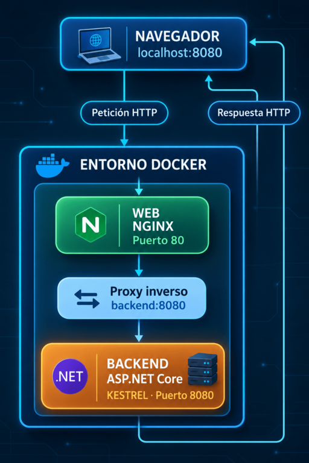

# NovaHarvest

## 1. ARRANQUE

### Ejecución del docker

- Para inicializar NovaHarvest, abriremos una terminal en la carpeta del proyecto y ejecutamos:

```bash
docker compose up -d --build
```

- Comprobamos que los contenedores estén funcionando con:

```bash
docker compose ps
```

Accederemos a la aplicación desde el navegador:

- **Inicio** -> http://localhost:8080/
- **Acerca de** -> http://localhost:8080/about
- **Estado server** -> http://localhost:8080/estado
- **Estilos** -> http://localhost:8080/css/styles.css
- **Logo** -> http://localhost:8080/logo.png

Para detener los contenedores:

```bash
docker compose down
```

### Ejecutar sin Docker

Entramos en la carpeta del backend:

```bash
cd backend/NovaHarvest.Web
```

Ejecutamos la aplicación:

```bash
dotnet run
```

La aplicación se ejecuta directamente mediante Kestrel. Para acceder a ella, utilizamos la dirección que aparece en la terminal al iniciar el servidor. Para detenerla, pulsamos `Ctrl + C`.


## 2. ARQUITECTURA
NovaHarvest utiliza Nginx como proxy inverso y ASP.NET Core como backend.

El navegador envía las peticiones a Nginx, que las recibe por el puerto 80 del contenedor web, publicado en el puerto 8080 del equipo. Después, Nginx reenvía las peticiones al backend mediante el puerto 8080 de la red interna de Docker.

El backend utiliza ASP.NET Core y Kestrel para procesar las peticiones y generar las páginas HTML.

## 3. DIAGRAMA DE ARQUITECTURA



## 4. RECORRIDO DE LAS PETICIONES 

El recorrido que realiza las peticiones es:

1. El usuario introduce la URL en el navegador.
2. NGINX recibe la petición.
3. NGINX reenvía dicha petición por la red interna de Docker.
4. Kestrel procesa la petición y ejecuta el código C# correspondiente.
5. El backend la devuelve a NGINX.
6. NGINX entrega respuesta al navegador.